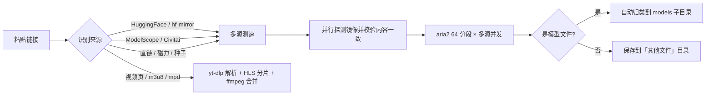

<picture>
  <source media="(prefers-color-scheme: dark)" srcset="docs/hero-dark.svg">
  
</picture>

<p align="center">
  <b>v1.1.1</b> &nbsp;·&nbsp; Windows 10 / 11 (64-bit) &nbsp;·&nbsp; MIT &nbsp;·&nbsp; .NET 10
  <br>
  <a href="../../releases/latest">下载</a> &nbsp;·&nbsp;
  <a href="../../issues">反馈</a> &nbsp;·&nbsp;
  <a href="../../actions">构建状态</a>
</p>

> **粘一条链接，剩下的交给它。**
> 软件、压缩包、镜像、视频都能下；如果下的是模型，它会自动认出来，放进 ComfyUI 对应的 `models` 子目录。

**MDV** 取自作者名字 **Mandydavi** 的缩写。它不做「又一个下载器皮肤」，而是把两件最烦的事一起做掉：**找到最快的源**，**放到对的目录**。

---

## 1.1.1 更新：图标修正

- **标题栏「配色」按钮**：原来的「圆圈 + 竖线」（远看像 Φ）换成水滴图标，15px 下也能一眼认出是配色入口
- **「检查更新」「断点续传」「重新扫描」**：刷新图标重绘成双弧双箭头，不再是只有一截短线的缺口圆
- 无功能改动，已在 1.1.0 的直接覆盖更新即可

## 1.1 更新：界面重做、布局重构、下载能力升级

这一版是完整的界面重做，不是换皮。旧版把「粘贴链接 + 开始下载」做成了全屏常驻输入框，导航平铺 8 项、设置拆成 4 页弹窗；1.1 把这些全部收回成一套有层级的桌面应用。

| 方向 | 旧版 | 1.1 |
|---|---|---|
| **界面** | 单一深色 + 高饱和橙，图标混用 Unicode 与 emoji | 冰蓝为默认主色，提供冰蓝 / 青柠 / 柔紫 / 暖珊瑚四套，深色浅色双主题；统一线性图标 |
| **布局** | 输入框全屏常驻，设置是 780×552 弹窗 | 标题栏只做标题栏，输入区只在工作台；导航收敛为 5 个入口；设置改为单页分节、内容限宽、操作条吸底 |
| **任务** | 统一 6 列表格 | 三段式：正在下载用大卡片、队列中用紧凑行、已完成与异常折叠展示 |
| **下载** | 单一源、固定分段 | 多源并发 + 一致性校验、64 分段、慢速自动补线程、视频解析与 HLS/DASH、BT 独立页 |
| **窗口** | 直角、无系统圆角 | 跟随系统圆角、无黑描边，标题栏与边缘自然过渡 |

### 界面升级

- **五入口导航**：工作台、文件库、已完成、磁力 / BT、设置，每项带实时计数与选中竖条
- **四套配色即时切换**：标题栏圆点或「设置 → 外观」里选，切换不需要重启
- **支持作者只留一处**：右上角按钮，点开是应用内收款码，不跳浏览器
- **所有弹窗统一**：确认、自检、设计说明、打赏都用同一套界面内弹层，不再是系统 MessageBox

### 布局大改

- **工作台**：加高的新建下载输入框（粘贴 / 清空内置）+ 独立底部操作条（保存位置、种子入口、开始下载），下面接仪表盘五格、筛选工具条与三段任务区
- **文件库**：目录卡片网格完整展示目录名、文件数与体积，下面是最近文件列表，双击即在资源管理器打开
- **已完成**：按天分组的记录列表 + 完成数 / 累计体积 / 完成率三块统计
- **磁力 / BT**：独立页面，粘磁力或选 `.torrent` 后原地显示进度，不再挤在工作台
- **设置**：外观、保存位置、下载速度、下载行为、更新与关于五个分节，改完即生效，底部固定「恢复默认 / 取消 / 保存设置」
- **滚动与窗口**：整页滚轮可用，切换页面回到顶部；窗口四角跟随系统圆角，四周没有多余描边

### 下载能力升级

- **多源并发**：同一文件的多个镜像一起交给 aria2，分段落到不同 CDN，带宽跨源叠加。只有「首 64 KB 指纹 + 文件总长」都一致的源才会被采用，不会把不同镜像拼进一个文件
- **64 分段 + 慢速补线程**：按文件大小自动决定分段数；速度掉到峰值 1/3 以下时从断点重启并加大分段，最多 2 次
- **视频与流媒体**：粘网页地址即可。yt-dlp 解析站点视频（最高清晰度 / 1080p / 720p / 仅音频）；HLS/m3u8 分片并发 + AES-128 解密 + ffmpeg 合并；DASH/mpd 交给 yt-dlp
- **BT / 磁力**：aria2 原生 BitTorrent 模式，DHT + PeX，种子与磁力独立成页
- **浏览器嗅探**：配套扩展在网页视频上悬停出现「用 MDV Tool 下载」，右键链接也能一键发送到主程序
- **启动优化**：引擎探测先查程序目录、WinGet 扫描限深并移到后台，启动从 8 秒级降到 2 秒内

## 三秒上手

| | |
|:--:|---|
| **1** | 从 [Releases](../../releases/latest) 下载 `MDVTool-1.1.1-SingleFile.exe`，双击即用 |
| **2** | 把链接粘进输入框，或直接把 `.torrent` 拖进来 |
| **3** | 点「开始下载」。测速、选源、归类，它自己完成 |

下载引擎是内部实现细节：界面里看不到它，缺了会在启动时或开始下载前静默补齐，不弹窗、不用手动配。

## 里面发生了什么



## 它凭什么快

| | |
|---|---|
| **多源并发（关键差异）** | 不再「挑一个最快的源」，而是把同一文件的多个镜像**一起**交给 aria2，让不同分段落到不同 CDN，带宽跨源叠加。探测并行完成（约 1.5 秒），只采用首 64 KB 指纹与文件总长都一致的源。 |
| **64 分段 + 慢速补线程** | 连接数上限 64，按文件大小自动分段；速度持续掉到峰值 1/3 以下时断点重启并加大分段。小文件不盲目开 64 段，限速站点保留单连接策略。 |
| **四源候选** | HuggingFace、hf-mirror、ModelScope、Civitai，另有 GitHub raw / jsDelivr 等通用镜像映射。关掉多源并发即回到串行测速选源。 |
| **断点续传** | 中断后从断点继续，下 11 GB 的模型也不怕断网；自动补线程与失败重试都基于同一个控制文件续传。 |
| **视频线同样快** | HLS/m3u8 默认 24 分片并发（含 AES-128 解密），DASH 交给 yt-dlp 16 分片并发，普通媒体直链仍走 aria2 64 分段。 |
| **自动归类** | 模型落到 `loras` / `vae` / `diffusion_models`；开启「自动分类归档」后，普通文件按视频 / 音乐 / 程序 / 压缩包 / 文档 / 图片分子目录。 |

## 它能下什么

**通用下载** —— 默认走「其他文件」目录，任何站点都不需要预先支持

- HTTP / HTTPS 直链：软件安装包、ZIP / 7z / RAR、ISO 镜像、视频、字体……
- 磁力链接与 `.torrent` 种子（独立「磁力 / BT」页）

**模型下载** —— 自动归到 ComfyUI 目录

- HuggingFace、hf-mirror、ModelScope、Civitai
- 按类型落到 `diffusion_models` / `loras` / `vae` / `text_encoders` / `controlnet` / `upscale_models` / `embeddings`
- 粘仓库地址会先列出文件清单让你挑，不用自己拼下载链接

**视频与流媒体** —— 粘网页地址即可，不用去扒真实播放链接

- 常见视频站点页面（yt-dlp 支持的站点）：可选最高清晰度 / 1080p / 720p / 仅音频，音视频分离时用 ffmpeg 合并
- `m3u8` / HLS 直播回放：分片并发下载、AES-128 解密、合并成 MP4（没装 ffmpeg 时保留 TS 流）
- `mpd` / DASH：交给 yt-dlp 按分片并发下载并封装

## 下载哪一种

发布页同时提供五种形态，按需要选一个：

| 文件 | 适合 | 说明 |
|---|---|---|
| `MDVTool-1.1.1-SingleFile.exe` | 只想拿一个 exe | 首次运行自解包到 `%LOCALAPPDATA%`，之后按版本复用 |
| `MDVTool-1.1.1-Portable.zip` | 放 U 盘、拷走就用 | 解压后双击 `MDV Tool.exe`，不写注册表 |
| `MDVTool-1.1.1-Setup.exe` | 想要安装与卸载入口 | 带安装向导，建开始菜单 / 桌面快捷方式与卸载项 |
| `MDVTool-1.1.1-Bundle.zip` | 内网分发、装机合集 | 主程序、安装器、浏览器扩展分目录放好，附 MANIFEST |
| `MDVTool-1.1.1-Update.zip` | 已在用旧版 | 只含主程序与引擎，覆盖即可更新 |

> **仅支持 Windows 10 / 11（64 位）**，发布包自包含，不需要安装 .NET 运行时。
> macOS 与 Linux 不支持——界面是 C# / WPF 写的，WPF 只有 Windows 有。

## 全部功能

- **并发上限**：同时下几个由你定，其余自动排队
- **全局限速**：限制总带宽，不影响家里人看视频
- **代理**：HTTP / SOCKS5，只对下载引擎生效，不改系统设置
- **同名文件策略**：询问 / 覆盖 / 跳过 / 重命名
- **磁盘空间预检**：空间不够提前拦下，不会下到 99% 才失败
- **托盘常驻**：下载完成弹通知，不占任务栏
- **关闭行为三选一**：收进托盘继续下载 / 每次询问 / 直接退出
- **自动更新**：启动后静默检查，有新版在状态条提示
- **深色 / 浅色主题 + 四套主色**：标题栏或设置页即时切换
- **历史与统计**：按天分组、完成数 / 累计体积 / 完成率，可导出 CSV
- **队列多选批量操作**：Ctrl / Shift 多选后批量暂停 / 继续 / 删除 / 全选
- **极速引擎开关**：多源并发、64 分段、慢速补线程可在「设置 → 下载速度」单独开关
- **浏览器嗅探桥**：只监听 `127.0.0.1:18765`，关闭开关即停

## 浏览器扩展

在 Chrome / Edge 打开 `chrome://extensions`，开启「开发者模式」→「加载已解压的扩展程序」→ 选择仓库里的 `extensions/BrowserExtension/` 目录。主程序需保持运行且「浏览器嗅探桥」为开启状态；扩展会先 `/ping` 探测，主程序没开时静默忽略。

## 它不做什么

把边界写清楚，比多写十个功能更重要：

- 不解析他人的网盘分享链接，不绕过任何限速或会员机制
- 不内置、不分发任何模型文件，只提供下载能力
- 不上传你的下载记录、文件内容或任何使用数据
- 没有付费版、没有功能限制、没有每日次数

## 赞助

软件免费、源码全开，打赏全凭自愿，不影响任何功能。

<table>
  <tr>
    <td align="center"><b>微信支付</b></td>
    <td align="center"><b>支付宝</b></td>
  </tr>
  <tr>
    <td></td>
    <td></td>
  </tr>
</table>

> 打赏不换取任何特权，也不影响 issue 的处理顺序。

<details>
<summary><b>给开发者：构建、目录、发版、更新机制</b></summary>

### 从源码构建

需要 [.NET 10 SDK](https://dotnet.microsoft.com/download)：

```
dotnet publish src/MDVTool.Desktop/MDVTool.csproj -c Release -r win-x64 ^
  --self-contained true -p:PublishSingleFile=true -p:EnableCompressionInSingleFile=true -o out
```

需要出全套发布包（Setup / Portable / SingleFile / Bundle / Update）时：

```
powershell -ExecutionPolicy Bypass -File scripts\pack.ps1
```

产物统一写到 `dist/`。

### 目录结构

| 路径 | 内容 |
|---|---|
| `src/MDVTool.Desktop/` | 主程序（WPF），`Sources/` 为下载源适配器 |
| `src/MDVTool.Pack/`、`src/MDVTool.Setup/` | 打包器与安装器 |
| `extensions/BrowserExtension/` | 浏览器嗅探扩展 |
| `scripts/` | 打包、发版、安装器构建脚本 |
| `bin/` | 运行所需二进制（aria2c、安装器） |
| `dist/` | 发布产物 |
| `docs/` | 文档、更新日志、分发说明、设计参考 |
| `version.json` | 更新检查用的版本元数据 |
| `.github/workflows/release.yml` | 打 tag 自动构建发版 |

新增下载站点：在 `src/MDVTool.Desktop/Sources/` 实现 `IModelSource`，并在注册表加一行即可。

### 更新机制

客户端启动 10 秒后检查更新：先读仓库的 `releases.atom` 拿到最新 tag，再取该 tag 下的 `version.json`；版本更高就在状态条提示，点击跳到 Release 页面。

用 tag 地址而不是分支地址，是为了绕开 jsDelivr 对 `@main` 最长 12 小时的缓存。取不到时会自动回退到 jsDelivr 分支地址、raw.githubusercontent 和 gcore 镜像。

### 发版

```
git tag v1.1.1 && git push origin v1.1.1
```

GitHub Actions 会编译、重命名成 `MDVTool-1.1.1-SingleFile.exe` / `.zip`、算 SHA-256 并建 Release。

</details>

## 致谢与许可

本程序自身代码以 [MIT](LICENSE) 许可发布。

发布包内含 [aria2](https://aria2.github.io/)（GPLv2）用于离线可用，未做任何修改；源码与许可见其官方仓库。yt-dlp 与 ffmpeg 为可选组件，按需获取，遵循各自许可。